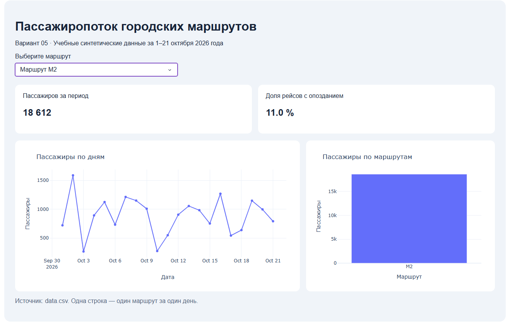

## Результаты анализа

Имя и фамилия: Даниил Гельфер.

Группа: ШАДк-111

Вариант: 05.

Исходный файл: datasets/variant_05.csv → data.csv

1. Самый загруженный маршрут за весь период: Маршрут М3 перевёз 39352 пассажира.
2. Максимальный суммарный пассажиропоток за день: 9 Октября 2026 года было перевезено 5756 пассажиров.

